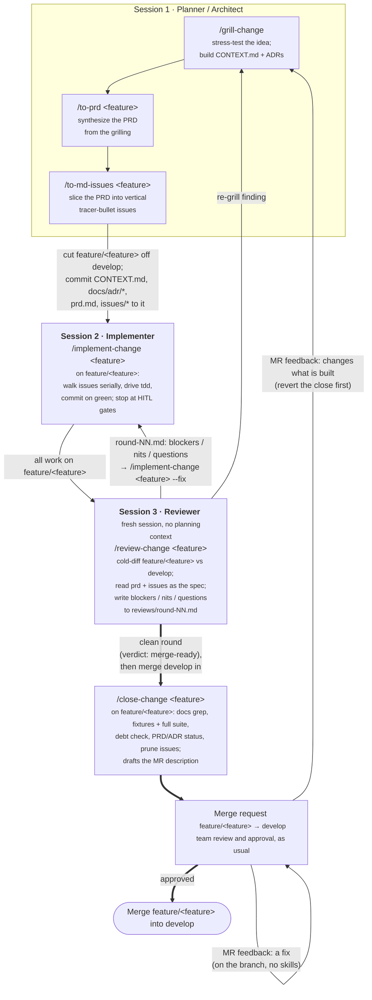

# The Pause - a phased AI development methodology

> *The value is in the pause, not the speed.*

Skills, slash commands, standards and hooks for building software with an AI agent in three
separate sessions: plan, implement, review. A human decides at every boundary.

An agent is most dangerous when it is confident and unsupervised across a large change. So the work
is split into three roles, **Planner**, **Implementer** and **Reviewer**, each in its own session.
The skills do the mechanics inside a phase. You own the transitions.

Everything here is local files you copy or link into place. Nothing to install, nothing phones home.

---

## The workflow at a glance

A feature goes through three sessions (three terminal tabs, or three Claude Code windows). Each one
commits files the next one reads. That committed spec is the bridge between sessions, not chat
history.



Why separate sessions: the reviewer must not remember the planning rationale. It judges the diff
against the written spec, the way a new reviewer would. That is what keeps the review honest.

In practice the tabs are named **Architect**, **Developer** and **Reviewer**. A typical moment: the
Developer tab has read the PRD and six issue stubs, printed the dependency order (each issue's
`Blocked by` line links the slices), and stopped for a pre-flight check before the first issue.

---

## Session 1 - Planner

Goal: agree on *what* to build and commit it, before any implementation code.

### `grill-change [KEY]`

Start from an idea, a doc or a wiki page pasted into the session. Or pass a ticket key
(`grill-change PROJ-123`) and the skill fetches the ticket and quotes it back first.

It then runs Matt Pocock's `grilling` and `domain-modeling` skills. It interviews you one decision
at a time, down the design tree, with its recommended answer at each branch. Along the way it
updates:

- **`CONTEXT.md`** - the domain glossary. Domain language only, no implementation detail. It calls
  out terms you use that conflict with it.
- **`docs/adr/`** - an ADR, offered sparingly: only for decisions that are hard to reverse,
  surprising without context, and the result of a real trade-off.

You stop when you and the agent agree on what to build.

A change already in progress can be reopened: by a re-grill finding from review, or by MR feedback
that changes what is built. Run `grill-change <name>` on the change branch (after a close, revert
the close commit first: it restores the spec the skills look for). It reads the frozen
spec, grills only the reopened decision, and the freeze skills then amend the spec in place: issue
and step numbers never change, and anything already implemented is never edited.

### `to-prd <feature-name>`

Writes the PRD from the grilling. It does not interview you again. Output:
`docs/features/<feature-name>/prd.md` (problem, solution, user stories, implementation and testing
decisions, out of scope).

### `to-md-issues <feature-name>`

Slices the PRD into vertical tracer-bullet issues: thin end-to-end paths, each demoable on its own.
Each issue gets a **Type** (`AFK`: the agent can build it, `HITL`: a human decides something first)
and a **Verification** (`AFK`, or `HITL`: a human confirms it works). Output:
`docs/features/<feature-name>/issues/<NN>_<slug>.md`, numbered in dependency order.

**End of session 1:** cut `feature/<feature-name>` off an up-to-date `develop` (`to-md-issues`
prints the commands) and commit `CONTEXT.md`, `docs/adr/*`, `prd.md` and `issues/*` to it. Nothing
is pushed to `develop`: the spec reaches it through the same merge request as the code. If your team
wants to see the plan before any code exists, push the branch now and open a draft MR.

---

## Session 2 - Implementer

### `implement-change <feature-name>`

Run it on `feature/<feature-name>`, the branch session 1 cut. It walks the issues one at a time:

- one subagent per issue, driving the `tdd` skill (red, green, refactor)
- when it returns: the issue's new tests, then the unit tier; both must be green
- commit on green, then the next issue

The slow tiers (integration, e2e) run once at the end of the run, not per issue.

It runs unattended except at `HITL` issues, where it stops and hands over to you. No worktrees, no
parallelism. The output is a clean sequence of commits on the feature branch.

The same skill implements a rework ticket (`implement-change PROJ-123`). The work items are then the
numbered steps in `docs/rework/PROJ-123/ticket.md`, step 0 is always the characterisation tests, and
the branch is `rework/PROJ-123`.

---

## Session 3 - Reviewer

### `review-change <feature-name>`

Run it in a fresh session with no planning context. It diffs the feature branch against `develop`,
reads `prd.md` and the issues as the spec, and writes findings to
`docs/features/<feature-name>/reviews/round-NN.md`, a local file that is gitignored and never
committed. Rounds stay in the checkout that wrote them: to continue a review on another machine,
copy the `reviews/` directory over. Findings:

- **re-grill** - a decision that goes back to planning
- **blockers**, **nits**, **questions** - for the implementer or for you

Each finding is tagged `introduced`, `amplified` or `pre-existing`, so you can tell what the branch
caused from what it only surfaced.

**The loop:** back in the session 2 tab, run `implement-change <feature-name> --fix`. It reads the
latest round by itself, shows what it will fix, skip (re-grill findings) and hand back to you
(questions), then fixes behind the same test gates: one commit per blocker, one for all the nits.
Then review again (`round-02.md`, ...). Repeat until a round is clean.

A clean round is one whose verdict is `merge-ready`: no re-grill findings, no blockers, no nits the
branch introduced or made worse, no open questions. Findings that predate the branch and that it did
not make worse never hold the verdict; they are listed as follow-ups. (The exception: what a rework
ticket set out to fix.) Answers to questions, and findings you decide not to fix, are given in the
reviewer session, which records them in the round. You can drop a finding during the round with a
reason.

**Sync before closing.** `develop` moves while you work. When a round is clean, merge the current
`develop` into the change branch (`git fetch`, then `git merge origin/develop`, or your remote's
name; your local `develop` may be stale). Merge, never rebase: later rounds narrow from recorded
SHAs. If the merge is clean and touches no file the branch changed (`CONTEXT.md` and the ADRs
aside), you are done and `close-change` accepts it. If it has a conflict or shares a file with the
branch, run `review-change` once more: that round skips what arrived from `develop` and reads only
the conflict resolutions and the shared files. `close-change` refuses a branch that is behind
`develop`.


### `mutation-testing` (optional)

After a clean review, finds gaps in test quality: it mutates the code and reports the mutants your
tests don't catch. It asks for the tool, paths and exclusions before running. Tests it leads you to
add are new commits, so run one more review round before closing.

---

## Closing, then the merge request

### `close-change <feature-name>`

Run it on the change branch after a clean round, before the merge request. It greps the docs for
anything the change removed, confirms the fixtures are tracked, runs every test tier and the debt
check, then sets the PRD and ADR status and deletes the issue stubs. The result is
one last commit, `Close <feature-name>`, and a draft MR description: what the change does, what
review raised and how it was resolved, the suite results, the follow-ups. In the rework lane it also
carries what "behaviour unchanged" means, copied from the spec, because the spec file itself is
deleted by the close.

Closing before the merge means these checks can still hold it, and nobody pushes housekeeping to
`develop` afterwards.

### The merge request, as usual

A clean round and a clean close mean the branch is ready for human review, not that it is approved.
The skills come before your team's merge request and do not replace it: push the branch, open the
MR, and let it be reviewed and approved the way any other MR is. The review rounds are local files
and never committed, so the MR description carries their summary.

MR feedback takes one of two routes, and the test is whether it changes what is being built:

- **A fix** (a bug, a name, a missed case): fix it on the branch like on any MR. Re-run the tests
  with CI or the project's test command; the skills are not re-run.
- **A change to what is built:** that is a planning change, and the spec has to say it before the
  code does. Revert the close commit, run `grill-change <name>` with the feedback, let the freeze
  skills amend the spec, then implement the new items, review, sync and close again. Without the
  spec edit, the cold reviewer would flag the requested change as a deviation.

A rework is never converted into a feature mid-flight. If reviewers ask a refactor to change
behaviour, finish and merge the refactor as it is (or abandon it), then plan the behaviour change as
a separate feature.

After the merge, delete the local `reviews/` directory, and in the rework lane close the ticket in
the tracker. Nothing else is left to do.

---

## The rework lane - tickets, not features

A refactor, a dead-code removal or a cleanup ticket leaves behaviour unchanged. It has no user
stories, so a PRD would be ceremony. The rework lane keeps the same sessions and skills and swaps
only the spec:

| Stage | Feature lane | Rework lane |
|---|---|---|
| Understand | `grill-change` on the idea | `grill-change <KEY>`: fetches the ticket, quotes it, grills you |
| Freeze | `to-prd` + `to-md-issues` -> `docs/features/<name>/` | `to-rework <KEY>` -> `docs/rework/<KEY>/ticket.md`: ticket, plan, **Acceptance**, numbered **Steps** |
| Implement | `implement-change <name>` on `feature/<name>`, one commit per issue | `implement-change <KEY>` on `rework/<KEY>`, one commit per step; **step 0 is the characterisation tests** |
| Review | `review-change <name>` against the PRD and issues | `review-change <KEY>` against `ticket.md`; the bar is "behaviour unchanged" |
| Close | `close-change <name>` on the branch, before the MR: status headers, prune `issues/` | `close-change <KEY>` on the branch, before the MR: delete `docs/rework/<KEY>/`; the tracker is the record |

You never tell the skills which lane you are in. They work it out from which spec exists
(`grill-change` from its argument).

### The two lanes side by side, and where the branch is cut

Everything happens on the change branch. Session 1 cuts it and commits the spec there, so `develop`
is only ever written to by the merge request.

```text
Feature lane                            Rework lane
────────────────────────────────────    ────────────────────────────────────
grill-change                            grill-change <KEY>
to-prd + to-md-issues                   to-rework <KEY>
  └─ git checkout -b feature/<name>       └─ git checkout -b rework/<KEY>
        from develop        ◄── BRANCH CREATED HERE ──►      from develop
  └─ commit prd.md + issues/*             └─ commit ticket.md
        to the branch                           to the branch
                    ↓                                       ↓
implement-change <name>                 implement-change <KEY>
  └─ one commit per issue                 └─ one commit per step, step 0 first
                    ↓                                       ↓
review-change <name>                    review-change <KEY>
  └─ diffs feature/<name> vs develop      └─ diffs rework/<KEY> vs develop
  └─ writes reviews/round-NN.md           └─ writes reviews/round-NN.md
        (local, never committed)                (local, never committed)
  └─ then merge develop in; one more      └─ then merge develop in; one more
        round only on conflict/overlap          round only on conflict/overlap
                    ↓                                       ↓
close-change <name>                     close-change <KEY>
  └─ checks, status, prune;               └─ checks, delete docs/rework/<KEY>/;
        last commit on the branch               last commit on the branch
                    ↓                                       ↓
merge request → develop                 merge request → develop
  └─ team review, approval, merge         └─ team review, approval, merge
```

---

## Ordinary changes - no lane

Some changes have nothing to decide, so there is nothing to grill and a spec would be ceremony:

- a bugfix that restores behaviour the docs, the spec or the tests already intended;
- a dependency bump, a docs, config or CI change;
- a mechanical cleanup too small to need a ticket and a characterisation step.

They skip both lanes:

1. Cut a branch off `develop`. Nothing is committed to `develop` directly, in a lane or out of one.
2. Work in an ordinary session. For a bugfix, run `diagnose`: reproduce, minimise, fix, and leave a
   regression test where there is a seam for one.
3. Commit with the normal protocol (audit, propose, wait for the OK).
4. Open the merge request as usual.

The test for which route applies is not size: would grilling have a real question to ask? If the
work means deciding what the behaviour should be, changing a contract, or reshaping code whose
behaviour has to be pinned first, it is a feature or a rework. If that turns out to be the case
half-way through, stop, commit or discard the partial work, and start the lane from `grill-change`. An
ordinary change gets no cold review from `review-change`, only the merge request's.

---

## Supporting skills and commands

| Tool | What it does |
|------|------|
| `to-rework` | Freezes a grilled rework ticket into `docs/rework/<KEY>/ticket.md`. The rework twin of `to-prd`. |
| `close-change` | Closes a reviewed change on its branch, before the merge request: docs grep, every test tier, debt check, status headers, prune specs, draft MR description. |
| `handoff` | Compacts the current session into a hand-off doc. Ad hoc, not part of the lanes: use it to pass work to another session or repo, or when a session's context gets large (say 400k+ tokens): `/handoff`, `/clear`, and carry on from the doc. |
| `diagnose` | A debugging loop for hard bugs and perf regressions: reproduce, minimise, hypothesise, instrument, fix, regression-test. |
| `walk-me-through` | Lays out Claude's understanding of a problem one short step per turn, marking what was checked and what was inferred, with the recommendation last. Ad hoc, not part of the lanes. |
| `/check` | Runs the quality gate: lint, format, type-check, security scan, tests. Python/Databricks only. |
| `/debt-check` | Flags cognitive debt in current work: magic numbers, undocumented business rules, unvalidated assumptions. |
| `/debt-review` | Turns `.claude/cognitive_debt.md` into a prioritised action list. |

---

## What's in this repo

```
the-pause/
├── README.md                          # this file
├── LICENSE                            # MIT, for everything original here
├── ATTRIBUTION.md                     # who authored which skill, plus upstream licence notice
├── settings.example.json              # hooks + sensible defaults to copy
├── standards/
│   ├── CLAUDE.md                      # stack-agnostic methodology + standards (repo root)
│   └── rules/                         # topic rules → <repo>/.claude/rules/
│       ├── testing.md                 # stack-agnostic testing standards (always install)
│       ├── python-tooling.md          # Python: ruff/pyright/bandit/pytest conventions
│       └── databricks-pipelines.md    # PySpark / Delta / DAB config, patterns, deployment
├── skills/                            # 12 skills (see ATTRIBUTION.md for provenance)
│   ├── tdd/  diagnose/  handoff/                           # Matt Pocock's (vendored)
│   ├── to-prd/  to-md-issues/                              # derived from Matt Pocock's
│   ├── to-rework/                                          # ours (rework-lane twin of to-prd)
│   └── grill-change/  implement-change/  review-change/  close-change/  mutation-testing/  walk-me-through/   # ours
├── commands/
│   ├── check.md  debt-check.md  debt-review.md             # active
│   └── _deprecated/research.md  _deprecated/spec.md        # see "Evolution" below
└── hooks/
    └── capture_decisions.sh           # appends DECISION/ASSUMPTION/DEBT markers to cognitive_debt.md
```

---

## Setup

1. **Standards.** Copy `standards/CLAUDE.md` to your repo root as `CLAUDE.md`, and
   `standards/rules/testing.md` to `<repo>/.claude/rules/`. On Python + Databricks, add
   `python-tooling.md` and `databricks-pipelines.md` there too. Keep them as separate files, each
   under ~200 lines; that is what keeps the agent following them. The `## Agent skills` block in
   `CLAUDE.md` is already set up for local markdown issues. Add three lines to the repo's
   `.gitignore`: `docs/features/*/reviews/` and `docs/rework/*/reviews/` (review rounds are local
   working notes, never committed) and `.claude/implement-change-state.json` (the implementer's
   per-developer state). If the repo already has committed rounds from an earlier version of this
   workflow, untrack them once:
   `git rm -r --cached --ignore-unmatch 'docs/features/*/reviews' 'docs/rework/*/reviews'`.

2. **Skills.** Symlink each skill into `~/.claude/skills/` (user-wide) or `<repo>/.claude/skills/`:
   `ln -s <the-pause>/skills/<name> ~/.claude/skills/<name>`. One link per skill, so your own skills
   can sit beside them. An edit here is then live in your next session. Copy instead only if the
   profile is on another machine.
   `grill-change` also needs Matt Pocock's `grilling` and `domain-modeling` skills, installed from
   [`mattpocock/skills`](https://github.com/mattpocock/skills); they are not vendored. You can take
   his three vendored skills from there too. See `ATTRIBUTION.md`.

3. **Commands.** Copy `commands/*.md` into `~/.claude/commands/` or `<repo>/.claude/commands/`.
   `/check` assumes Python/Databricks; adapt or skip it.

4. **Hook (optional).** Copy `hooks/capture_decisions.sh` to `<repo>/.claude/hooks/` and merge the
   `PostToolUse` entries from `settings.example.json` into `.claude/settings.json`. It collects
   `# DECISION:`, `# ASSUMPTION NEEDED:` and `# DEBT:` comments into `.claude/cognitive_debt.md`
   (Python files only, for now).

---

## Evolution of the planning phase

Planning used to be two slash commands, `/research` and `/spec`, that each wrote a document for
sign-off. They are kept under `commands/_deprecated/` as history. Don't use them.

A document written *for* the human gets rubber-stamped. An interview that forces a decision at every
branch surfaces the disagreements a document hides. So the grilling skills replaced them: the
conversation is where the shared understanding forms, and `CONTEXT.md`, the ADRs and the PRD fall
out of it.

---

## Credits

The planning and TDD skills come from **Matt Pocock**
([`mattpocock/skills`](https://github.com/mattpocock/skills)). [`ATTRIBUTION.md`](./ATTRIBUTION.md)
says exactly what is his, what is derived, and what is original here.
